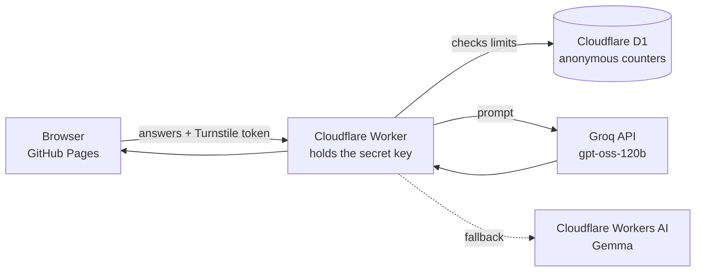

# Recruiter-Me

**Practise job interviews with an AI recruiter, in your language, and get an honest scorecard at the end.**

**Live:** https://dhanush-satish-reddy.github.io/recruiter-me/


## What it does

1. **Choose your interview:** working student (Werkstudent), internship, first job, or paste a real job ad.
2. **Answer like it's real:** the AI recruiter asks one question at a time, follows up on vague answers and adapts to the style you pick (friendly, realistic or tough).
3. **Read your scorecard:** five categories scored 1 to 10 (structure, relevance, evidence, motivation, communication), what worked, what to improve, a stronger version of your weakest answer and, for job ads, where you match and where you have gaps.

It works in any language. You pick one at the start, and if you answer in another, the recruiter switches. The interface is in English and German.

## Why I built it

I'm a Wirtschaftsingenieurwesen (Engineering and Management) student at THI Ingolstadt. Many students, including many international students in Germany, have never had a realistic interview before their first real one. Recruiter-Me makes practice free, private and available in the language you think in.

I wanted the project to show product thinking as well as working software: a clear user problem, a hard €0 budget, protection against abuse, GDPR-conscious design, and honest limits.

## How it works



- **Front end:** plain HTML, CSS and JavaScript on GitHub Pages. No framework, no build step, no trackers, self-hosted fonts.
- **Backend:** one Cloudflare Worker. It is the only place that knows the AI API key, so the key never reaches the browser.
- **AI:** Groq's free tier. Free limits apply per model, so the backend uses a chain of production models (`gpt-oss-120b`, then `gpt-oss-20b`, then `llama-3.3-70b-versatile`). A model that has used up its daily allowance is skipped until the next day, and Cloudflare Workers AI is the last fallback.
- **State:** the conversation lives only in the visitor's browser tab. The Worker is stateless apart from anonymous daily counters.

## Security and abuse protection

| Risk | Protection |
|---|---|
| Stolen API key | Key stored as a Cloudflare secret. The website never sees it. |
| Bots draining the free quota | Cloudflare Turnstile check before every interview. |
| One person spamming | Max 3 interviews per browser per day and 14 messages per interview. The scorecard has its own 3 tries, so a long interview never costs anyone their scorecard. A looser cap per internet connection (30 interviews per day, 150 messages per hour) stops scripts, while a whole campus or office sharing one IP address can still use it. |
| Many people at once | Global cap of 60 interviews and 900 AI calls per day. When every free model has used up its daily allowance, new interviews are refused with a clear "come back tomorrow" instead of failing halfway. |
| Huge inputs | Answers ≤ 1,200 characters, job ads ≤ 6,000, request body ≤ 64 KB. |
| Slow AI providers | One time budget per answer across all models, retries and the backup (35 s for questions, 50 s for the scorecard), so nobody waits minutes for an error. |
| Other websites using the backend | Browsers only allow this site to call the backend (CORS allow-list). Scripts can fake that header, so the real protection is the human check, signed sessions and the limits. |
| Forged or replayed sessions | HMAC-signed session tokens that expire after 1 hour. |
| Faked recruiter messages | Every recruiter message is signed by the backend. The browser must send the signature back, so nobody can invent or edit recruiter messages to smuggle in instructions. |
| Flooding the API to use up the free quota | Limits are checked before the trick filter, so blocked messages count too. Past a limit, requests only read counters and write nothing. |
| Prompt injection ("ignore your instructions…") | Three layers: a pattern filter blocks obvious attacks before any AI call (saving quota), fixed safety rules in the system prompt treat all user text and job ads as data, and an output check blocks any reply that would leak the instructions (canary token). The filter only matches phrases addressed to the AI, so genuine answers like "I had to show the rules to new colleagues" pass; unit tests cover both directions. |
| Off-topic use (homework, code, etc.) | The recruiter declines in one sentence and returns to the interview. |
| Fake "system" messages from the client | The backend only accepts `assistant` and `user` roles in a valid order. |

## Zero-cost design

Every service runs on a free plan with no payment method on file. On these plans, going over a limit makes requests fail. It can't create a bill.

| Service | Free limit used | What happens if it's exceeded |
|---|---|---|
| GitHub Pages | Static hosting for public repos | — |
| Cloudflare Workers | 100,000 requests/day | Requests fail until midnight UTC |
| Cloudflare D1 | 5M rows read, 100k rows written per day | Queries fail until midnight UTC |
| Cloudflare Turnstile | Free, no request cap | — |
| Groq API (free tier) | Per model: 1,000 requests and 200,000 tokens per day | API returns HTTP 429, and the Worker moves to the next model |
| Cloudflare Workers AI | 10,000 Neurons/day | Calls fail, and the visitor sees "come back tomorrow" |

Google's Gemini free tier was considered and rejected: its terms only allow paid services for apps offered to users in the EEA, Switzerland and the UK.

## Privacy

- No accounts, no cookies of our own, no analytics.
- Conversation content is not stored by this project. The AI providers process it under their own data protection terms.
- Rate limiting uses daily-rotating hashes of the IP address and of a random browser ID, never the values themselves. A nightly scheduled job deletes them after their day ends.
- Full notice in German and English: [`docs/privacy.html`](docs/privacy.html)

## Project structure

```
recruiter-me/
├── docs/                    Website (served by GitHub Pages)
│   ├── index.html
│   ├── privacy.html
│   ├── css/style.css
│   ├── js/app.js            Interview flow, report, Turnstile
│   ├── js/i18n.js           English and German interface texts
│   ├── js/config.js         Public settings (backend URL, Turnstile site key)
│   └── fonts/               Self-hosted Newsreader and Hanken Grotesk (OFL)
├── worker/                  Backend (Cloudflare Worker)
│   ├── src/index.js         API, limits, sessions, AI calls
│   ├── src/prompts.js       Fixed safety rules and prompt building
│   ├── src/playbook.md      Editable interviewer behaviour and scoring rubric
│   ├── test/api-test.mjs    Automated API tests
│   └── wrangler.toml        Worker configuration and limits
└── TESTS.md                 Manual test list, including attack attempts
```

## Changing how the recruiter behaves

Edit [`worker/src/playbook.md`](worker/src/playbook.md) on GitHub (pencil icon, then "Commit changes"). Cloudflare redeploys automatically. The playbook controls persona, interview styles, topics and the scoring rubric. The safety rules live in code and can't be weakened by editing it.

## Run it locally

Requirements: Node.js 20 or newer.

```bash
cd worker
npm install
printf 'DEV_MODE=1\nMOCK_AI=1\n' > .dev.vars   # mock AI, no keys needed
npx wrangler dev --local --port 8787
# in a second terminal, from the repository root:
python3 -m http.server 8000 --directory docs
# open http://localhost:8000
```

Run the tests:

```bash
cd worker
node test/unit-test.mjs          # pure helpers, no server needed
node test/api-test.mjs           # needs the dev server from above
bash test/chain-test.sh          # model chain against a fake Groq server (starts its own servers)
```

## Deploy your own copy

1. Fork this repository.
2. Cloudflare dashboard: **Workers & Pages → Create → Import a repository**, choose your fork, set the root directory to `worker`.
3. Create a D1 database and put its ID in `worker/wrangler.toml`.
4. Add the secrets `GROQ_API_KEY` and `TURNSTILE_SECRET` under **Settings → Variables and Secrets**.
5. Put your Worker URL and Turnstile site key in `docs/js/config.js`, and your site's address in `ALLOWED_ORIGINS`.
6. GitHub: **Settings → Pages → Deploy from branch → `main` / `docs`**.

## Known limitations

- The free AI quota covers a few dozen full interviews a day. On a busy day, visitors are asked to come back tomorrow.
- AI feedback can be wrong. The scorecard says so and should be read as a second opinion.
- The pattern filter for prompt injection only covers English and German phrases. Other languages rely on the model's rules and the output check.

## Credits

Designed and built by **Dhanush Satish Reddy**, with code written together with an AI coding assistant (Claude).
[LinkedIn](https://www.linkedin.com/in/dhanushreddy05) · [Website](https://dhanush-satish-reddy.github.io)

Fonts: [Newsreader](https://github.com/productiontype/Newsreader) and [Hanken Grotesk](https://github.com/marcologous/hanken-grotesk), SIL Open Font License.

## License

Code: [MIT](LICENSE).
